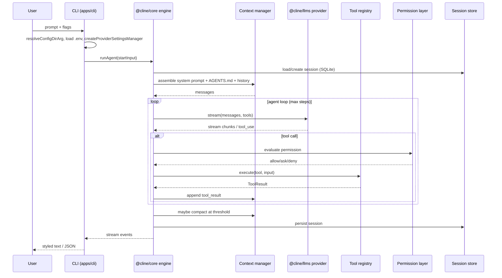

# 01 — As-Is HLD: Zenuxs-AI-Agent

Derived from source inspection AND real execution on 2026-11-18, SHA `816c9a7`.
Evidence: `docs/evidence/P0/*.log`. Status values: WORKING / PARTIAL / BROKEN / MISSING.

## 1. What the product actually is

The repository is a **Cline-derived monorepo rebranded as Zenuxs**. The working CLI (`apps/cli`) depends on `@cline/core` and `@cline/shared` (128 and 63 import sites respectively). A second, parallel set of `@zenuxs/*` packages (`schema`, `engine`, `providers`, `lsp`, `plugin-sdk`, `studio`) exists but currently does **not** compile and is **not** imported by the CLI. This is the single most important structural fact about the as-is system.

`apps/cli` runs (`bun apps/cli/src/index.ts --help` exits 0) and exposes a rich command surface, but the repo-level build, typecheck, extension build and both unit suites are red (see `docs/evidence/P0/`).

## 2. Layer diagram (as-is)

```mermaid
flowchart TB
  subgraph UI["UI surfaces"]
    CLI["CLI (headless / -p plan / args)\napps/cli/src/index.ts, main.ts"]
    TUI["TUI (OpenTUI/React)\napps/cli/src/tui/*"]
    EXT["VS Code extension\napps/vscode-extension/src/*"]
    HUB["Zenuxs Hub (dashboard/webview)\napps/zenuxs-hub/*"]
  end

  subgraph TRANSPORT["Transport UI -> core"]
    INPROC["In-process dynamic import\n@cline/core"]
    WS["WebSocket hub\nws://127.0.0.1:46323/hub"]
    ACP["ACP (Agent Client Protocol)\napps/cli/src/acp/*"]
    RPC["Extension core-bridge (in-process)\napps/vscode-extension/src/runtime/core-bridge.ts"]
  end

  subgraph CORE["Core runtime"]
    ZCORE["ZenuxsCore facade\npackages/core/src/ZenuxsCore.ts"]
    ENGINE["Cline core engine\npackages/core/src/engine/*"]
    SESS["Session store / history\npackages/core/src/session/*"]
    CTX["Context + compaction\npackages/core/src/extensions/context/*"]
    HOOKS["Hooks\npackages/core/src/hooks/*"]
    SKILLS["Skills\npackages/core/src/skills/*"]
    CRON["Cron / schedule\npackages/core/src/cron/*"]
    SETTINGS["Settings\npackages/core/src/settings/*"]
    ALTENG["Parallel @zenuxs/engine\npackages/engine/src/* (BROKEN)"]
  end

  subgraph PROV["Provider layer"]
    LLMS["@cline/llms\npackages/llms/src/providers/*"]
    ALTPROV["@zenuxs/providers\npackages/providers/src/* (BROKEN)"]
  end

  subgraph TOOLS["Tool system"]
    TOOLREG["Tool registry / policies\napps/cli/src/runtime/tools.ts, tool-policies.ts"]
    CORETOOLS["Built-in tools in @cline/core"]
    ALTTOOLS["@zenuxs/engine tools\npackages/engine/src/tools/* (BROKEN)"]
  end

  subgraph SAFETY["Safety"]
    PERM["Permission evaluator\npackages/engine/src/permission/* (BROKEN)"]
    CKPT["Checkpoints\napps/cli/src/runtime/defaults.ts + @cline/core"]
  end

  subgraph EXTENS["Extensibility"]
    MCP["MCP client\n@cline/core + @zenuxs/engine/src/mcp/*"]
    PLUG["Plugin manager\napps/cli/src/commands/plugin.ts"]
    SUB["Subagents\napps/cli/src/commands/debug-agents.ts + @cline/core"]
  end

  subgraph PLATFORM["Platform"]
    CFG["Config\napps/cli/src/utils/*, packages/core/src/settings/*"]
    LOG["Logging / telemetry\napps/cli/src/logging/*, src/utils/telemetry.ts"]
    STORE["SQLite / storage\n@cline/shared/storage, packages/engine/src/store/*"]
  end

  CLI --> INPROC
  CLI --> ACP
  CLI --> WS
  TUI --> INPROC
  EXT --> RPC
  EXT --> WS
  HUB --> WS
  INPROC --> ZCORE
  RPC --> ZCORE
  ACP --> ZCORE
  ZCORE --> ENGINE
  ENGINE --> SESS
  ENGINE --> CTX
  ENGINE --> HOOKS
  ENGINE --> SKILLS
  ENGINE --> CRON
  ENGINE --> SETTINGS
  ENGINE --> LLMS
  ENGINE --> TOOLREG
  TOOLREG --> CORETOOLS
  TOOLREG --> ALTTOOLS
  ENGINE --> PERM
  ENGINE --> CKPT
  ENGINE --> MCP
  ENGINE --> PLUG
  ENGINE --> SUB
  ENGINE --> STORE
  ZCORE --> LOG
  CFG --> ENGINE
  ALTPROV -.-> ZCORE
  ALTENG -.-> ZCORE
```

## 3. Layer responsibility table

| Layer | Responsibility | Inputs | Outputs | Owning modules | Contract | Failure modes | Status |
|---|---|---|---|---|---|---|---|
| CLI entry | Arg parse, subcommands, signals, env load | argv, stdin, env | runCli() | `apps/cli/src/index.ts`, `main.ts`, `commands/program.ts` | Commander program | `--help` works; build fails on webview | PARTIAL |
| CLI headless | Non-interactive task, `--json`, `-p` plan mode | prompt, flags | streamed messages / JSON | `apps/cli/src/runtime/run-agent.ts` | Cline core events | not yet exercised with fake provider | PARTIAL |
| TUI | Streaming chat, slash menu, status bar, approvals | core events | keystrokes -> core | `apps/cli/src/tui/*` (OpenTUI + React) | session context/event bridge | 1 failing unit test in command palette | PARTIAL |
| VS Code ext | Chat webview, editor tools, terminal, status bar | webview messages | core calls | `apps/vscode-extension/src/*` | `core-bridge.ts` postMessage protocol | extension build fails (exit 2) | BROKEN |
| Hub | Local daemon, dashboard, connectors | WS | hub state | `apps/zenuxs-hub/*`, `@cline/core/hub` | WebSocket JSON | doctor reports hub not healthy | PARTIAL |
| Core (Cline) | Agent loop, sessions, context, hooks, skills, cron | start input | stream events | `packages/core/src/*` | `ClineCoreStartInput` | 34 failing unit tests | PARTIAL |
| Core (Zenuxs facade) | Intended unified API | — | — | `packages/core/src/ZenuxsCore.ts` | — | thin facade; parallel engine unused | PARTIAL |
| Parallel engine | Tool registry, sessions, compaction, MCP, permissions | — | — | `packages/engine/src/*` | Zod schemas | does not compile | BROKEN |
| Schema | Shared types | — | — | `packages/schema/src/*` | zod v4 | compiles with 11 errors | BROKEN |
| Providers | LLM calls | prompts | streams | `packages/llms/src/providers/*` | Cline provider API | builds OK; live keys absent | PARTIAL |
| Tools | read/write/edit/glob/grep/shell/web/todo | model tool calls | tool results | CLI tool policies + core tools | tool definitions | registry exists but alt tools broken | PARTIAL |
| Safety | permissions, checkpoints | tool call | allow/deny | `packages/engine/src/permission/*` | — | does not compile | BROKEN |
| Config | global/project/env config | files, env | Config object | `apps/cli/src/utils/*`, core settings | 15 type errors in CLI | PARTIAL |
| Logging | pino + telemetry (opt-in) | events | logs | `apps/cli/src/logging/*` | — | works | WORKING |

## 4. Sequence: one user turn (as-is, headless)

## 5. Evidence of working vs broken (real runs)

| Command | Exit | Evidence |
|---|---|---|
| `bun install --frozen-lockfile` | 0 | (1259 packages) |
| `bun apps/cli/src/index.ts --help` | 0 | `docs/evidence/P0/cli-help.log` |
| `bun apps/cli/src/index.ts doctor` | 0 | hub unhealthy |
| `bun run build` | 2 | `docs/evidence/P0/build.log` |
| `bun run --cwd apps/cli build` | 1 | `docs/evidence/P0/cli-build.log` |
| `bun run --cwd apps/cli typecheck` | 2 | `docs/evidence/P0/cli-typecheck.log` |
| `bun run build:extension` | 2 | `docs/evidence/P0/ext-build.log` |
| CLI unit tests | 1 (30 failed) | `docs/evidence/P0/cli-unit-test.log` |
| Core unit tests | 1 (34 failed) | `docs/evidence/P0/core-unit-test.log` |

## 6. Key as-is observations

1. **Two cores.** The CLI uses `@cline/core`; `@zenuxs/engine` and `@zenuxs/schema` are an abandoned parallel implementation that breaks every build. This violates the "one core, one protocol" rule and is the top reconstruction target.
2. **Zod major mismatch.** `z.record(x)` (v3 API) is used against installed zod 4.4.3 (v4 needs `z.record(k, v)`). This is the first build error and cascades everywhere.
3. **Self-reexport anti-pattern.** 75 source files use `export * as X from "."` inside `index.ts`, which TypeScript treats as a redeclaration when `X` is also a local export. Violates the project's own AGENTS.md convention (`export * as Foo from "./foo"`).
4. **Branding leakage.** Package names `@cline/core`, `@cline/agents`, `@cline/shared`, `@cline/llms`; CLI author `Cline Bot Inc.`; homepage `cline.bot`; keywords include `cline`. Must be kept functionally but rebranded where safe (see DECISIONS).
5. **Leaked config.** Root `config.json` (UTF-16LE, 273 KB) contains Windows user paths and a large agent config dump — flagged as a potential secret/PII leak.
