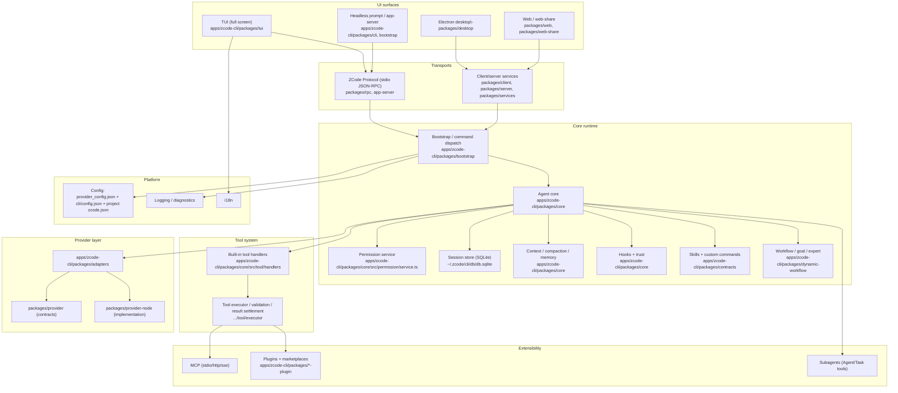
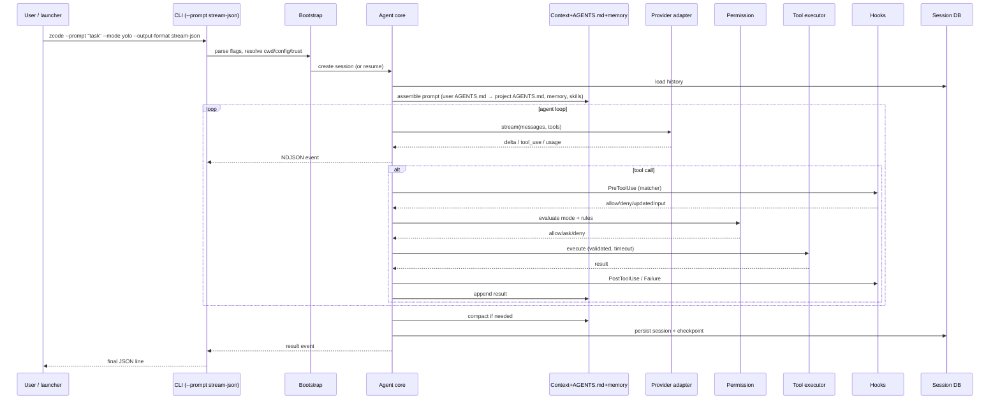

# 02 — Reference HLD: ZCode (read-only study)

Derived from source, docs and real execution of `zcode.cjs` 0.17.0 on 2026-11-18.
Evidence: `docs/evidence/reference/*.log`, `docs/recon/ref-features.md`.

## 1. Layer diagram

## 2. Layer table

| Layer | Responsibility | Inputs | Outputs | Owning modules | Contract | Failure modes |
|---|---|---|---|---|---|---|
| CLI bootstrap | arg parse, flags, commands, dispatch | argv, env | app-server/TUI/prompt run | `apps/zcode-cli/packages/cli`, `bootstrap` | Commander-like flags | unsupported flag → exit 1 |
| TUI | full-screen interactive UI, slash commands | protocol events | user input | `packages/tui` | ZCode Protocol | no display → blocked |
| Headless | `--prompt`, `--target`, stream-json | prompt text | NDJSON events + result | `packages/cli`, `bootstrap` | `{sessionId,traceId,response,eventCount,projection}` | no approval client → tool fails |
| app-server | stdio protocol endpoint | JSON-RPC lines | JSON-RPC lines | `packages/rpc`, `packages/cli` | ZCode Protocol | malformed JSON |
| Core agent | loop, modes, tools, permission, sessions | session/turn | events | `apps/zcode-cli/packages/core` | core event stream | retries, max steps |
| Permission | mode policies, allow/ask/deny, hooks | tool call | decision | `core/src/permission/service.ts` | allow/ask/deny | no client, hook deny |
| Session | SQLite persistence, checkpoints, resume | session ops | records | core + `~/.zcode/cli/db/db.sqlite` | sessionId, traceId, turnId | WAL/corruption |
| Context | AGENTS.md, memory, compaction | messages | context | core memory/context modules | compaction events | stale files |
| Tools | 16 built-ins, MCP, plugins | tool call | result | `core/src/tool/handlers` | schemas | bad JSON, timeout |
| Provider | 3 API protocols, streaming | request | stream | `packages/provider*`, `adapters` | normalized stream | 429/5xx, tool-call diffs |
| Plugins | install/marketplace/lifecycle | manifest | skills/commands/hooks/MCP | `*-plugin` packages | `.zcode-plugin/plugin.json` | untrusted hooks |
| Config | two config files + env + project | JSON | typed config | adapters config schema | schemaVersion 1 | bad field → config skipped |

## 3. Full-turn sequence

## 4. Real evidence of reference behavior
- `--help`: 10 commands, 20 flags, 15 slash commands (`docs/evidence/reference/ref--help.log`).
- `doctor --json`: version 0.17.0, node bundle packaging (`refdoctor___json.log`).
- `commands list --json`: 3 plugin-contributed commands discovered (`refcommands_list___json.log`).
- `plugins list --json`: 12+ official plugins with skill/command/MCP/hook contributions (`refplugins_list___json.log`).
- Docs confirm: 7 hook events, 3 MCP transports, 5 modes, 2 config files, SQLite session DB, stream-json NDJSON.

## 5. Notable reference behaviors to emulate
- `--prompt` defaults to `yolo`; non-interactive prompt has no approval client → interactive tools fail.
- `--output-format stream-json` emits NDJSON with a final `type:"result"` line; unknown event types must be preserved.
- Permission denial can still result in exit code 0; check tool results and artifacts.
- Project hooks are untrusted by default; digest-bound review/grant/revoke.
- AGENTS.md assembly: user first, then project.
- Checkpoints power `/rewind` and `/fork`.
- Custom commands come from markdown with frontmatter and `$ARGUMENTS`.
