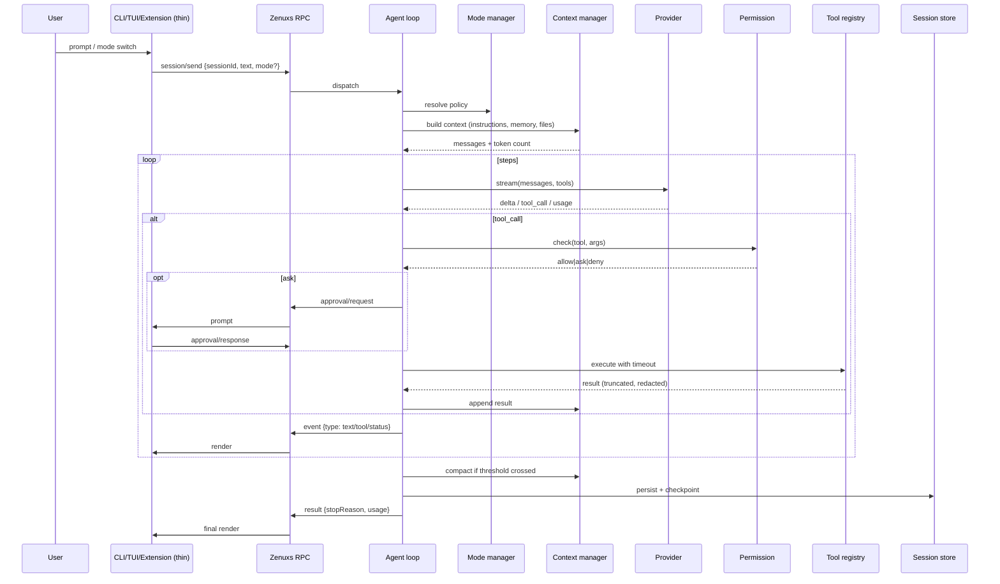

# 04 — Target HLD: one core, one protocol, parity+

Goal: a single core (`@zenuxs/engine`) shared by CLI/TUI, headless mode and the VS Code extension through one defined protocol. The Cline-derived packages remain as a compatibility layer only until all features are reimplemented/verified; no business logic in UIs.

## 1. Target layer diagram

```mermaid
flowchart TB
  subgraph UI["UI surfaces (thin, no business logic)"]
    CLIUI["CLI / headless\napps/cli"]
    TUIUI["TUI\napps/cli/src/tui"]
    EXTUI["VS Code webview\napps/vscode-extension"]
  end

  subgraph PROTO["One protocol: Zenuxs RPC (JSON-RPC 2.0 over stdio, WS, in-process)"]
    RPC["SessionClient / SessionServer\npackages/engine/src/rpc/*"]
    SCHEMA["Protocol schemas (@zenuxs/schema)\npackages/schema/src/rpc/*"]
  end

  subgraph CORE["@zenuxs/engine — single core"]
    LOOP["Agent loop\nagent/runtime.ts"]
    MODE["Mode manager\nagent/modes.ts"]
    PROMPT["Prompt assembler\nagent/prompt.ts"]
    CTX["Context manager + compaction\nsession/context-epoch.ts, compaction.ts"]
    SESS["Session store\nsession/manager.ts, sqlite-store.ts"]
    TOOLREG["Tool registry\ntool/registry.ts"]
    PERM["Permission engine\npermission/evaluator.ts"]
    CKPT["Checkpoints\nsession/checkpoints.ts"]
    STREAM["Event stream / abort\nstream/events.ts"]
  end

  subgraph TOOLS["Built-in tools"]
    T1["read / write / edit / apply_patch"]
    T2["glob / grep / list"]
    T3["bash (timeout, cwd, bg, kill)"]
    T4["web_fetch (SSRF) / web_search"]
    T5["todo / git / semantic_search / subagent"]
  end

  subgraph PROVIDERS["Provider layer"]
    P1["OpenAI-compatible / OpenRouter"]
    P2["Anthropic"]
    P3["Gemini / Google"]
    P4["Ollama / local"]
    PN["Normalizer: streams, tool calls, 429/5xx, fallback"]
  end

  subgraph SAFETY["Safety & config"]
    CFG["Config: global/project/env + schema"]
    SECRET["Secrets: env + VS Code SecretStorage"]
    AUDIT["Audit log / redaction"]
  end

  subgraph EXTENS["Extensibility"]
    MCP["MCP client (stdio/HTTP/SSE)"]
    HOOK["Hooks (pre/post tool, session events)"]
    SKILL["Skills (discovery, progressive load)"]
    PLUG["Plugins (loader, lifecycle, isolation)"]
    CMD["Slash commands (built-in + custom)"]
    SUB["Subagents (context, depth/cost limits)"]
    AUTO["Automation (headless, schedules)"]
  end

  subgraph INTEL["Intelligence"]
    RAG["Indexer: chunking, embeddings, BM25, watcher, AST, ignore"]
  end

  CLIUI --> RPC
  TUIUI --> RPC
  EXTUI --> RPC
  RPC --> SCHEMA
  RPC --> LOOP
  LOOP --> MODE
  LOOP --> PROMPT
  LOOP --> CTX
  LOOP --> TOOLREG
  LOOP --> STREAM
  LOOP --> SESS
  TOOLREG --> PERM
  TOOLREG --> T1
  TOOLREG --> T2
  TOOLREG --> T3
  TOOLREG --> T4
  TOOLREG --> T5
  LOOP --> PN
  PN --> P1
  PN --> P2
  PN --> P3
  PN --> P4
  PERM --> CFG
  PERM --> AUDIT
  SESS --> CKPT
  CTX --> RAG
  TOOLREG --> MCP
  TOOLREG --> HOOK
  PROMPT --> SKILL
  PROMPT --> CMD
  LOOP --> SUB
  CLIUI --> AUTO
  SECRET --> CFG
  PLUG --> TOOLREG
  PLUG --> HOOK
```

## 2. Layer contracts

| Layer | Responsibility | Input | Output | Contract | Failure modes |
|---|---|---|---|---|---|
| RPC | UI↔core messages | JSON-RPC request | JSON-RPC response/notification | `packages/schema/src/rpc/*` ( SessionStart, SessionSend, SessionCancel, Event, ApprovalRequest/Response, ModeSet, ModelSet, SessionFork, SessionRewind, SessionExport, SessionList, Compact, CheckpointCreate, CheckpointUndo) | transport drop, version mismatch, malformed JSON |
| Agent loop | multi-step tool loop, abort, retries, max steps | SessionSend | stream events | `StreamEvent` union | provider errors, tool errors, abort |
| Mode manager | ask/plan/debug/code, prompt + tool permissions | ModeSet | active mode | `Mode` enum + policy | invalid mode |
| Context | token count, compaction, stale files | messages + files | assembled context | `ContextSnapshot` | token miscount, instruction loss |
| Session | persist/resume/list/fork/rewind/export | session ops | session state | `SessionRecord` | DB corruption, concurrent writes |
| Tool registry | schema validation, timeouts, truncation | ToolCall | ToolResult | `ToolDefinition`, `ToolExecutionContext`, `ToolExecutionResult` | bad JSON, timeout, huge output |
| Permission | allow/ask/deny, path/command patterns | ToolCall + policy | decision | `PermissionRequest`/`PermissionDecision` | traversal, injection |
| Provider | normalize streams/tool calls | provider request | stream chunks | `ProviderStreamChunk` | 429/5xx, malformed output |
| MCP | external tools/resources/prompts | MCP calls | results | MCP JSON-RPC | reconnect, auth, isolation |
| Config | precedence, validation | files/env | typed config | Zod schema | invalid values |

## 3. Full-turn sequence (target)

## 4. Invariants

- CLI and extension MUST call the same `@zenuxs/engine` package via the same `SessionClient` interface. No tool execution, prompt assembly or permission logic in UIs.
- All async operations accept an `AbortSignal`.
- Feature status VERIFIED requires L3 evidence from the real built artifact on current code.
- No ZCode branding, keys, endpoints or telemetry. Adapted code (if any) requires NOTICE entries.
